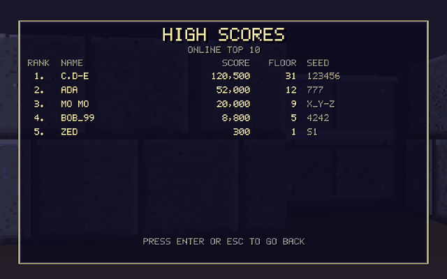

# Kersplat Labyrinth: The Descent

by **Eliminator Productions**

An original first-person maze shooter for the browser, inspired by classic 90s raycasters.
Explore rooms and maze corridors, find keys, throw water balloons at silly monsters, collect
coins, beat a boss every 5th floor, and see how deep you can go in endless procedurally generated floors.

Everything in the game (code, art, textures, sounds, music, levels) is original. Wall, monster,
boss, projectile and item art lives as PNG sheets in `assets/` and is packed into the single HTML
file by `tools/assets.mjs` (since M1.21). Sounds, music, the pixel font and some HUD or decoration
sprites are still generated in code. The whole game is one self-contained HTML file with no
external requests.

| | | |
|---|---|---|
|  |  |  |

## Run it

- Open `src/index.html` in a modern browser, **or**
- serve the folder statically, e.g. `npx serve src` or `python3 -m http.server -d src`.

The online high score board needs a same-origin API at `/api/labyrinth`
(contract: [docs/research/highscore-api.md](docs/research/highscore-api.md)). When it can't
be reached (opened from `file://`, offline, or no API on the host) the game falls back to a
local top-10 list in the browser, labelled LOCAL.

URL options: `?seed=<text>` plays a reproducible run; `?debug` exposes the test hook
(`window.__game`) in the release build.

## Repository layout

| Path | What |
|---|---|
| `src/index.html` | The current game (M1.43 release build). The single file *is* the source. |
| `builds/<milestone>/index.html` | Frozen builds M1 to M1.43, checksums in `builds/SHA256SUMS`. |
| `builds/m1.7-qa` … `builds/m1.43-qa` | **QA builds**: debug hook always on. For tests only; don't publish. |
| `assets/` | **Game art as PNG sheets** (walls, monsters, bosses, boss props and projectiles, item and power icons). Edit them, then `node tools/assets.mjs pack`. See `assets/README.md`. |
| `tools/release.mjs` | Freezes `src/` into a release + QA build pair (see Release below). |
| `tools/assets.mjs` | Embeds the PNGs in `assets/` into `src/index.html` (`pack`, `check`, `export`). |
| `tests/` | Playwright test suite, local high score API stub. |
| `docs/` | Plan, changelog, controls and features, balance, research notes, API contract. |
| `concepts/` | Original concept art from the M0 milestone. |

## Test

Needs Node 18+.

```sh
cd tests
npm ci
npx playwright install chromium
npm test                     # full suite against builds/m1.43 (+ builds/m1.43-qa)
node m1.test.mjs m1.8        # any older milestone: m1, m1.1 ... m1.43
```

Results and screenshots go to `test-output/<build>/` (gitignored). From M1.7 on, the
hook-based tests run on the `-qa` build and the release build is checked alongside it.
High score tests use the local stub `tests/hs_stub.mjs` (loopback only), never a live board.
To preview with the stub API: `cd tests && npm run stub`, then open `localhost:8787` in a browser.

Expected results: m1 54, m1.1 83, m1.2 106, m1.3 158, m1.4 195, m1.5 217, m1.6 238,
m1.7 256, m1.8 325, m1.9 388, m1.9.1 390, m1.10 412, m1.10.1 413, m1.10.2 416, m1.11 431, m1.11.1 431, m1.12 447, m1.12.1 447, m1.12.2 447, m1.13 453, m1.13.1 453, m1.14 458, m1.14.1 460, m1.14.2 461, m1.15 462, m1.16 465, m1.17 472, m1.17.1 472, m1.18 476, m1.19 477, m1.19.1 478, m1.19.2 479, m1.20 484, m1.21 487, m1.22 490, m1.23 462 (25 checks of the old items retired, replaced by M1.23 item checks), m1.24 464, m1.25 464, m1.26 470, m1.27 471, m1.28 481, m1.29 485, m1.30 489, m1.31 488, m1.32 488, m1.33 488, m1.34 488, m1.35 492, m1.36 499, m1.37 500, m1.38 501, m1.39 506, m1.40 510, m1.41 512, m1.42 512, m1.43 513 checks, all passing.

## Release

```sh
node tools/release.mjs dev --test          # test the current src/ as a throwaway build in .work/builds/
node tools/release.mjs dev m1.10 --test    # ...under the version it will get
node tools/release.mjs m1.10               # freeze builds/m1.10 + builds/m1.10-qa, update src/, SHA256SUMS, tests/package.json
```

Then write `builds/<version>/README.md` (and the QA one) and the changelog entry by hand.

## Credits

Game design, code and art: Eliminator Productions.
Map generation follows Bob Nystrom's "Rooms and Mazes" algorithm (2014), implemented from
the article's description.

Copyright (c) 2026 Eliminator Productions. All rights reserved. See [LICENSE](LICENSE).
